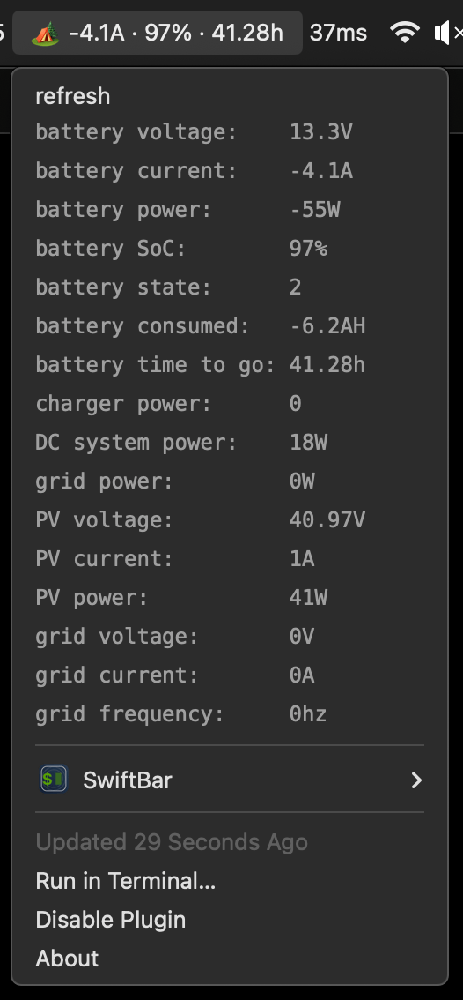

Looks like this:



## Setup

```sh
yarn install
./ssid/build.sh
./ssid/ssid.app/Contents/MacOS/ssid --authorize   # once, click Allow
```

`ssid.app` is not checked in. Without it `state-of-charge.js` shows nothing,
since it cannot tell whether you are on a network with the Victron. See
[ssid/README.md](ssid/README.md).

Symlink `state-of-charge.js` into your SwiftBar plugin directory as
`003-state-of-charge.30s.js`.
